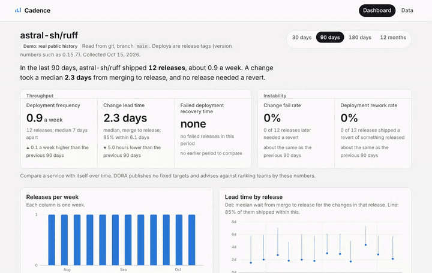

# Cadence

DORA software delivery metrics from a repository's history: how often a service ships, how long a change waits to reach users, how often a release has to be undone, and how quickly that happens. It reads git or the GitHub API, with no agents, webhooks or vendor accounts, and it runs entirely in the browser.

**[Try the demo](https://jasonzawacki-arch.github.io/cadence/)**: twelve months of real history from [astral-sh/ruff](https://github.com/astral-sh/ruff), a busy open-source project with weekly releases. No sign-in.



## What it shows

The five metrics in [DORA's current model](https://dora.dev/guides/dora-metrics/), grouped the way DORA groups them:

| | Metric | Read from version control as |
|---|---|---|
| Throughput | Deployment frequency | releases per week |
| | Change lead time | from a change merging to the main branch to the release that shipped it |
| | Failed deployment recovery time | from a failed release to the release that shipped its revert |
| Instability | Change fail rate | releases that shipped a change later reverted, out of all releases |
| | Deployment rework rate | releases that shipped a revert of something already released, out of all releases |

Each metric is compared with the previous period of the same length (30 days, 90 days, 180 days or 12 months). Alongside them:

- **Releases per week**, and **lead time by release**: the median wait for the changes in each release, a whisker to the 85th percentile, and releases that later needed a revert in red.
- **Change size**: median lines changed per merged change, and the share over 400 lines. Small batches are the lever DORA's research ties to both speed and stability.
- **Pull request cycle time**, when the data has pull requests.
- The releases that needed a revert, with the change and the fix, and the changes that waited longest for a release.

Every chart has hover and keyboard tooltips and a table view of its numbers.

Cadence does not rank teams or grade them against fixed thresholds. DORA dropped its elite/high/medium/low clusters in 2025 and advises comparing a service with its own past, which is what the dashboard does.

## How failures are found

A release counts as failed when it shipped a change that a later release reverted within 14 days. Two kinds of revert do not count:

- a revert that lands before the change was ever released, because nothing reached users;
- a revert months later, which is a change of direction rather than a failure that needed immediate attention.

Reverts are found from `This reverts commit <sha>` in the message (what `git revert` writes) or a `Revert "<subject>"` subject (what GitHub's revert button writes). A problem fixed forward with a new change, or rolled back outside git, is not visible this way, so pair the instability numbers with incident records where you have them.

## Two ways to load a repository

**Live from GitHub.** On the Data page, enter `owner/name` or paste the repository's link. Cadence reads the repository's published releases (pre-releases and drafts left out), the commits on the default branch, and merged pull requests, and counts each change in the first release published after it landed. A repository with no releases is read from its GitHub deployments instead (GitHub Pages, Actions environments and other deploy tools record these), preferring a production environment and counting a redeploy of the same commit once. Public repositories need no token. A token raises GitHub's limit from 60 to 5,000 requests an hour and opens private repositories. It is held in the page's memory only, sent only to `api.github.com`, and gone on reload.

**The collector script, for any git host.** [`collect/cadence_collect.py`](collect/cadence_collect.py) reads a clone on your own machine, so it works with GitHub, GitLab, Bitbucket or a company server, and nothing leaves the machine:

```sh
python3 cadence_collect.py path/to/repo --since 2025-10-01 -o cadence-data.json
```

- Deploys are release tags (`--deploy-tags`, default: version tags such as `1.4.2` or `v1.4.2`). Annotated tags are timed by the tagger date, lightweight tags by their commit.
- Changes are the first-parent commits on the branch (`--branch`), so a merged or squashed pull request counts once.
- Each change is mapped to the release that shipped it exactly, by walking the history between consecutive tags.
- Commit authors and file contents are not collected. Standard library only; it needs Python 3 and git.

Open the file it writes from the Data page. The page can also download whatever it is showing as a data file.

## Build and test

```sh
npm install
npm run build          # type-check, then write dist/cadence.html and dist/site/
pip install playwright && python -m playwright install chromium
npm test               # collector tests and browser tests
```

- `tests/test_collect.py` builds a scratch repository with annotated and lightweight release tags, a tag that is not a release, a change reverted after release and one reverted before, and checks what the collector writes.
- `tests/app.py` drives the dashboard in Chromium. Every metric for every period is checked against `tests/reference.py`, a separate Python reading of the same definitions. It also covers the collector file round trip, refusal of bad files, live mode against a mocked GitHub API (unknown repository, rate limit, no releases, and a token that never reaches storage or downloads), and the layout at phone widths.

The build is a small dependency-free bundler (`build.mjs`) that inlines the TypeScript, the CSS and the demo data into one HTML file. CI runs the tests on every push, and every push to `main` publishes `dist/site` to GitHub Pages, with the collector script beside the page.

## License

MIT
